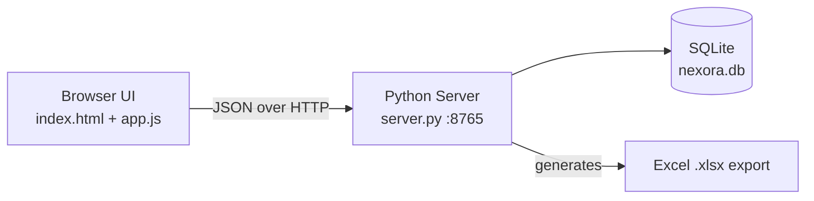

<div align="center">


# NEXORA ERP

**A multi-company manufacturing ERP for inventory, production, piecework wages and sales.**


[Features](#-features) •
[Quick Start](#-quick-start) •
[Architecture](#-architecture) •
[Roadmap](#-roadmap) •
[Limitations](#-current-limitations)

</div>

---

## 📖 Overview

**NEXORA ERP** digitizes the day-to-day operations of manufacturing businesses that run several companies and factory units, replacing scattered spreadsheets and manual records with one system.

It tracks stock, records production, calculates team piecework earnings from approved output, and handles multi-line sales billing, with company-wise and consolidated Excel reports.

> [!NOTE]
> This is the **v0.8 local prototype**. It runs entirely on your machine with zero external dependencies. See [Current Limitations](#-current-limitations) before using it with real business data.

---

## ✨ Features

| Module | What it does |
| --- | --- |
| 📊 **Dashboard** | Overview of companies, units, stock and activity at a glance |
| 🏢 **Companies & Units** | Manage multiple companies, each with its own factory units and data view |
| 📦 **Inventory** | Item catalogue with codes, categories, units of measure, stock levels, low-stock thresholds and a stock movement ledger |
| ⚙️ **Production** | Daily production entries per unit and worker with produced, rejected and accepted quantities plus approval status |
| ₹ **Piecework Wages** | Per worker, per product rates, with **bulk rate setting** across multiple units |
| 🧾 **Sales** | Multi-line bill / cart for a shop and company, with line totals and an overall bill total |
| 🏪 **Shops / Customers** | Reusable shop registry used when creating sales |
| 📥 **Excel Export** | One-click workbook for all data, or a dedicated report per company |

### Highlights in v0.8

- **Bulk piecework rates** – select a company, a product and one or more units, enter a common rate to prefill every worker, then adjust individual workers in a spreadsheet-style preview and save everything at once. Existing worker and item rates are updated instead of duplicated.
- **Multi-line sales bills** – pick the shop and company once, then add as many product rows as needed.
- **Company-wise Excel reports** – export sheets for Company, Factory Units, Inventory, Stock Ledger, Workers, Production and Piecework Rates.
- **Zero dependencies** – the backend uses only the Python standard library, and the Excel files are generated without any third-party package.

---

## 🚀 Quick Start

### Requirements

- Windows (the included launcher is a `.bat` file)
- [Python 3](https://www.python.org/downloads/) installed and available as `py` or `python`

No `pip install` is needed.

### Run

1. **Download** or clone the repository.

   ```bash
   git clone https://github.com/<your-username>/NEXORA-ERP.git
   cd NEXORA-ERP
   ```

2. **Start the server** by double-clicking `start.bat`, or from a terminal:

   ```bash
   python server.py
   ```

3. **Open** your browser at:

   ```
   http://127.0.0.1:8765
   ```

The server listens on `127.0.0.1` only, so it is reachable just from your own computer.

> [!TIP]
> Back up `nexora.db` before upgrading. v0.8 works with a v0.7 database and migrates it automatically.

---

## 🏗️ Architecture

```
NEXORA-ERP/
├── server.py       # Python HTTP server, REST API, SQLite access, Excel export
├── index.html      # Single-page interface and styling
├── app.js          # Frontend logic and API calls
├── nexora.db       # SQLite database
├── start.bat       # Windows launcher
└── README.md
```



### Tech stack

| Layer | Technology |
| --- | --- |
| Frontend | HTML, CSS, vanilla JavaScript |
| Backend | Python standard library (`http.server`) |
| Database | SQLite |
| Reports | Native `.xlsx` generation |

### Data model

`companies` → `units` → `workers`, `items`, `production`, `rates`, `sales`, `shops`, `movements`

Each company owns its units, and workers, items, production and sales are tied to a company (and unit where relevant).

### API endpoints

| Method | Endpoint | Purpose |
| --- | --- | --- |
| `GET` | `/api/data` | Load all application data |
| `GET` | `/api/export` | Download Excel (optional `company_id`) |
| `POST` | `/api/companies` | Create companies |
| `POST` | `/api/units` | Create factory units |
| `POST` | `/api/items` | Create catalogue items |
| `POST` | `/api/assign-catalog` | Assign catalogue items |
| `POST` | `/api/movement` | Record stock movements |
| `POST` | `/api/workers` | Create workers |
| `POST` | `/api/rates` | Set a worker's product rate |
| `POST` | `/api/bulk-rates` | Set rates across units in bulk |
| `POST` | `/api/production` | Record production |
| `POST` | `/api/shops` | Add shops / customers |
| `POST` | `/api/sales` | Create sales bills |

---

## 🗺️ Roadmap

NEXORA is planned as a full manufacturing business platform. The current prototype covers the first stage.

- [x] Companies and factory units
- [x] Inventory with stock movement ledger
- [x] Production records
- [x] Piecework rates with bulk rate setting
- [x] Multi-line sales bills and shop registry
- [x] Excel export (all data and per company)
- [ ] Authentication and role-based access control
- [ ] Production approval workflow and correction history
- [ ] Wage statements, advances and payment history
- [ ] Purchases and suppliers
- [ ] GST-compatible invoicing
- [ ] Expenses and double-entry accounting
- [ ] Bill of materials and automatic stock consumption
- [ ] PDF reports and scheduled backups
- [ ] Migration to PostgreSQL with a FastAPI backend and Next.js web client
- [ ] Windows desktop app (Tauri)

---

## ⚠️ Current Limitations

> [!WARNING]
> NEXORA v0.8 is a **local prototype**, not a secured production ERP. Do not store confidential business data until security, backup, audit and concurrency protections are implemented and verified.

- No login or role-based permissions yet
- Single local SQLite database, not designed for simultaneous multi-user access
- No GST integration or double-entry accounting yet
- No automated backups, so copy `nexora.db` regularly
- Do not expose the server to the internet

---

## 🤝 Contributing

Suggestions and bug reports are welcome. Please open an issue to discuss what you would like to change.

## 📄 License

No license has been specified yet. Add a `LICENSE` file to define how others may use this project.

---

<div align="center">

**NEXORA ERP** · Built for manufacturers who want clarity over their factories.

</div>
